<div align="center">

# Climate Black Box

**Climate projects are funded on a promise and judged on a final report.
After that report, almost nobody looks again.**

This is the instrument that keeps looking — and makes the record impossible to
revise after the fact.

Oracle Autonomous Database · Oracle APEX · OCI Generative AI · Nervos CKB · Landsat

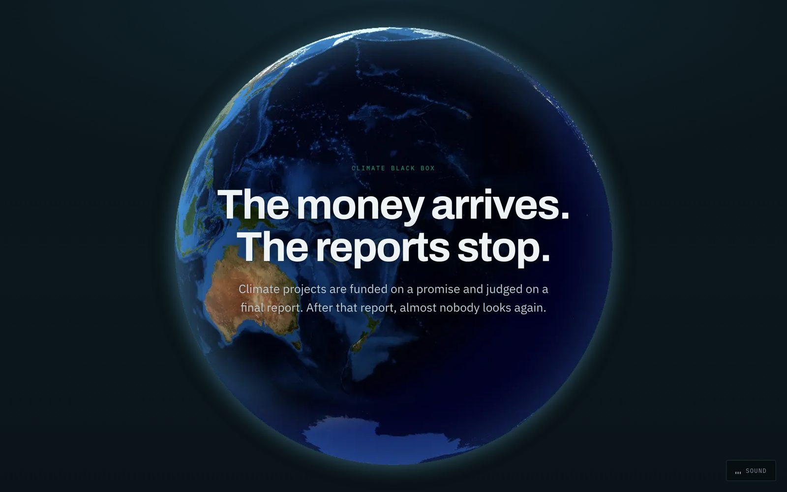

</div>

---

## The idea

Aircraft carry a flight recorder so that what actually happened survives the
people with a reason to describe it differently. Climate funding has no such
instrument. A project reports, the money moves, and the forest is on its own.

Climate Black Box watches two real Kenyan forest sites from orbit, month after
month, long after the reporting window would have closed. When a site diverges
from what was promised, it says so, explains what evidence that rests on, and
commits the whole record to a public blockchain so the finding cannot be
rewritten later — not even by us.

**The control site is the point.** Both sites run the identical rule. One
raised an alert. The other stayed quiet. A detector that fires everywhere
detects nothing.

| | Transmara, South-West Mau | Kiambu (control) |
|---|---|---|
| Monthly NDVI observations | 45 | 44 |
| Rainfall observations | 45 | 44 |
| Alerts raised | **1** | **0** |
| Evidence records anchored | 7 | — |

Same rule, same window, same pipeline. 178 observations in total.

---

## What it actually does

### 1 — Observe

Forty-five months of Landsat Collection 2 Level-2 surface reflectance, pulled
through Microsoft's Planetary Computer. NDVI is computed per scene with the
QA_PIXEL band unpacked to reject cloud, shadow, snow and water per pixel. A
month under 75% valid coverage can never raise an alert.

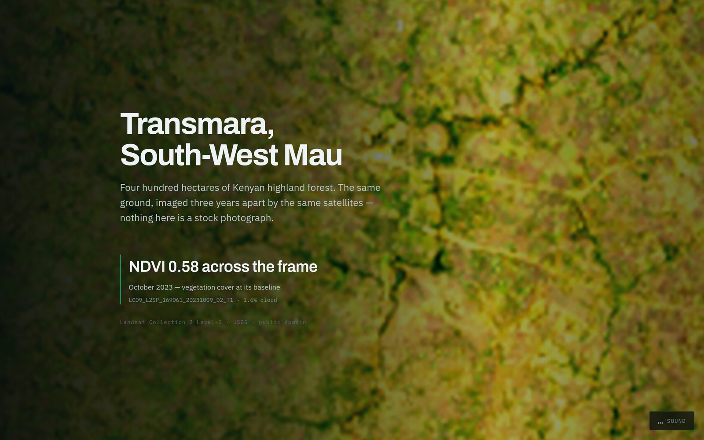

*Real imagery, with the scene ID and cloud fraction on screen. Nothing here is
a stock photograph.*

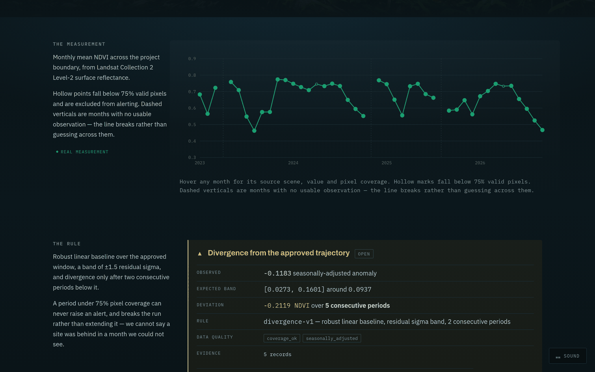

*Hollow points fall below 75% valid pixels. Dashed verticals are months with no
usable observation — the line breaks rather than guessing across them.*

### 2 — Detect

A robust Theil-Sen baseline over the approved window, a band of ±1.5 residual
sigma, and divergence declared only after **two consecutive** periods below it.

Every measurement is compared against the same calendar month in the baseline
rather than against a straight line — seasonal swing at this site is 0.218
NDVI against a full observed range of 0.312 — 70% of it. Skipping that step
produces a confident alert every February.

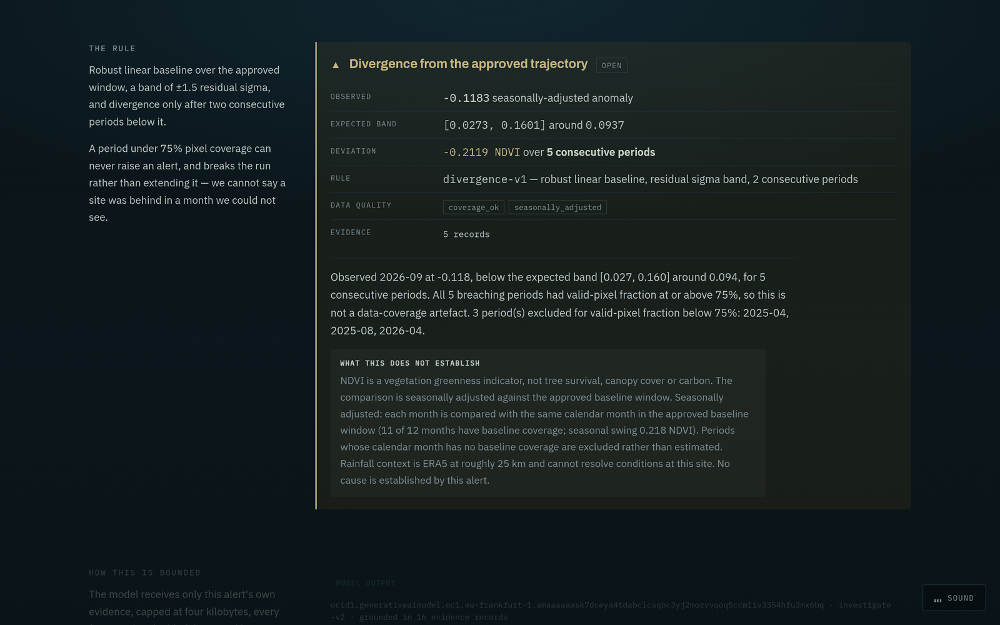

*The alert states its own limits. `NDVI is a vegetation greenness indicator,
not tree survival, canopy cover or carbon` is rendered next to the finding, not
buried in a footnote.*

### 3 — Investigate

An OCI Generative AI model (`meta.llama-3.3-70b-instruct`, running in
Frankfurt) is given **only this alert's own evidence**, capped at four
kilobytes. It returns competing hypotheses with confidence levels and what
would settle them.

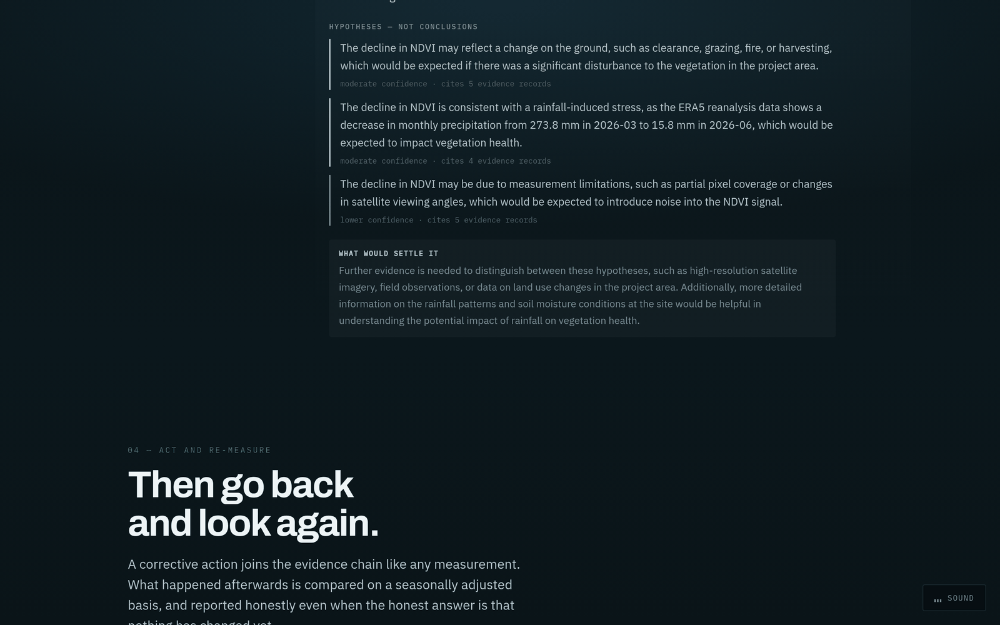

It is mechanically forbidden from asserting a cause. Output claiming one — or
citing an evidence record it was never given — is rejected and replaced by a
deterministic template, and the response says which of the two you are reading.

### 4 — Verify

Every evidence record is canonicalised, hashed, and committed to Nervos CKB,
each manifest carrying the hash of the one before it.

<table>
<tr>
<td width="50%">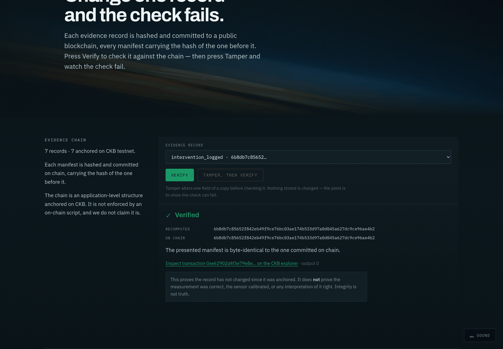</td>
<td width="50%">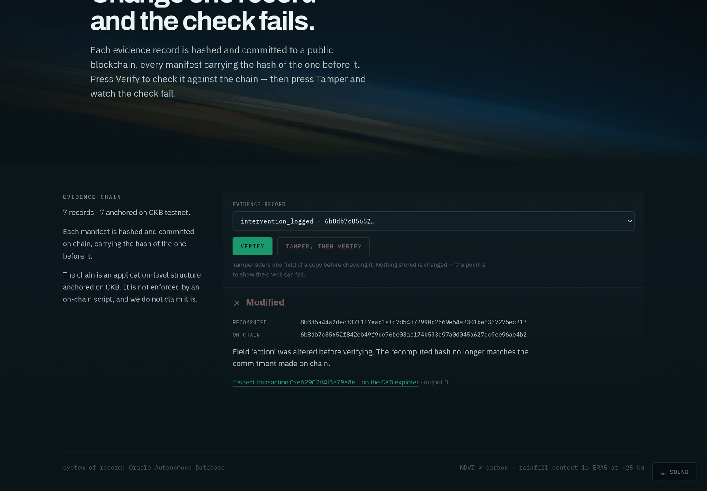</td>
</tr>
<tr>
<td><b>Verified.</b> Re-hashed from the database, matched against the chain.</td>
<td><b>Modified.</b> One field altered in a copy — the check fails immediately.</td>
</tr>
</table>

The failure path is a button, not a claim. Nothing stored is changed; the
tamper only alters a copy, so anyone can press it and watch integrity break in
real time.

> **Integrity is not truth.** Verification proves a record has not changed
> since it was anchored. It does not prove the measurement was correct, the
> sensor calibrated, or any interpretation of it right. The UI says so on the
> same screen.

### On a phone

The same page, the same live data — the type scale has a floor so nothing
collapses into unreadable 10px text, and the scroll sequences switch to a
compact scrub rather than pinning.

<p align="center">
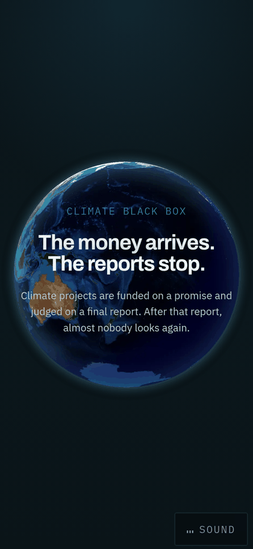
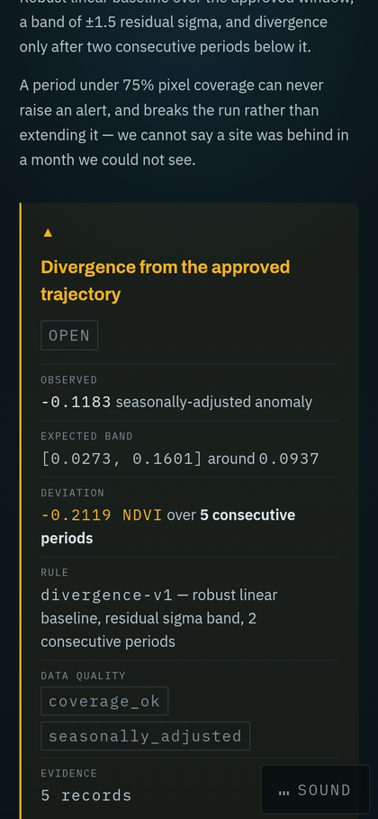
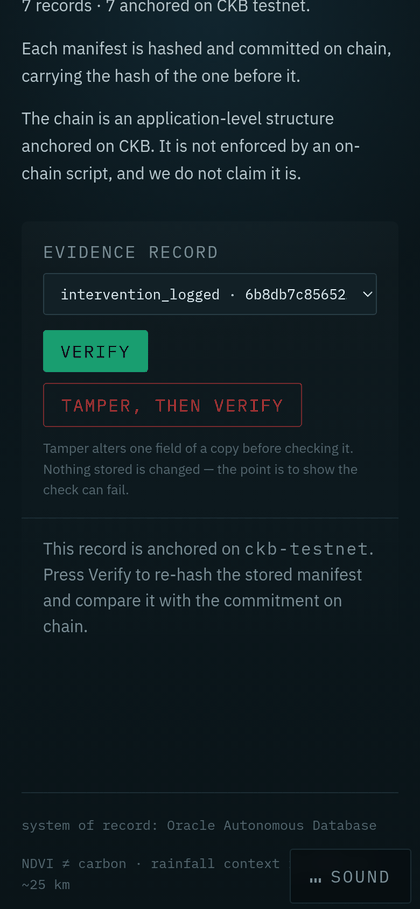
</p>

---

## Architecture

```
Landsat C2 L2 ──┐
(Planetary      ├──> analytics ──> Oracle Autonomous ──> FastAPI ──┬──> Next.js (the scrollable story)
 Computer)      │    NDVI,         Database (9 tables,            │
ERA5 rainfall ──┘    seasonal,     Spatial SDO_GEOMETRY)          └──> Oracle APEX (the operator console)
(Open-Meteo)         Theil-Sen            │
                                          ├──> OCI Generative AI (Frankfurt)
                                          └──> Nervos CKB testnet (anchoring + verification)
```

**Two front ends, deliberately.** The Next.js site is the narrative — it is
simultaneously the pitch and the live demo, running against real data. Oracle
APEX is the operator console: interactive reports over the same tables for
someone doing the job rather than hearing the story.

| Layer | Choice | Why |
|---|---|---|
| System of record | Oracle Autonomous Database | Evidence outlives the demo box; Spatial carries the boundaries |
| Operator UI | Oracle APEX | Interactive reports over the same tables, no second codebase |
| Reasoning | OCI Generative AI, Llama 3.3 70B | Stays in-region; evidence-bounded and output-validated |
| Integrity | Nervos CKB testnet | Cell model suits one commitment per record; batched into one tx |
| Imagery | Landsat C2 L2 via STAC | Free, public domain, 30 m, and genuinely re-derivable |

### Honest limits

Stated here because they are stated in the product too:

- **NDVI is greenness, not carbon.** It does not measure tree survival or canopy.
- **Rainfall is ERA5 at ~25 km** — district-level context, not site conditions.
- **The chain is application-level.** Manifests are anchored on CKB; this is
  not enforced by an on-chain script, and we do not claim it is.
- **Sites are demonstrators.** Real boundaries, real imagery, real measurements
  — but interventions are flagged `simulated` in the database, and the UI says so.

---

## Running it

```bash
make setup          # venv + dependencies, copies .env.example
# edit .env with your Oracle and OCI details
make db-reset       # migrate + seed
make load           # load the observation fixture
make test           # 132 passing, 9 skipped
```

Then, in two terminals:

```bash
make api
```

```bash
make web
```

The site is on `localhost:3000`, the API on `localhost:8000`.

| Command | What it does |
|---|---|
| `make ingest` | Re-run the Landsat + rainfall pipeline and diff against the fixture |
| `make anchor` | Anchor unanchored evidence to CKB testnet |
| `make verify` | Verify every anchored record against the chain |
| `make tamper` | Demonstrate that verification fails on an altered manifest |
| `make genai-check` | Report which OCI models this tenancy can actually use |

### Deploying

[`deploy/README.md`](deploy/README.md) covers deployment to an Always Free
Ampere A1 instance: three containers behind nginx, talking to the same
Autonomous Database. The whole stack was built and run against the real
database and testnet before that guide was written, and it records what was
verified.

### Setting up Oracle

[`docs/oracle-setup.md`](docs/oracle-setup.md) covers the console side —
Autonomous Database, wallet, APEX workspace, and enabling Generative AI.

---

## Repository

| Path | What is in it |
|---|---|
| `services/analytics/` | NDVI, seasonal adjustment, Theil-Sen trend, the alert rule |
| `services/ckb/` | Canonicalisation, manifest hashing, anchoring, verification |
| `services/genai/` | Evidence assembly, prompt, output validation |
| `services/api/` | FastAPI; 19 routes |
| `apps/web/` | Next.js 15, scroll-driven; the pitch and the demo in one page |
| `database/` | 9 core tables, spatial migration, views, APEX export |
| `deploy/` | Dockerfiles, compose, nginx, deployment guide |
| `scripts/` | Ingest, load, anchor, verify, imagery rendering |

### The deterministic core

Two properties the rest of the system leans on:

**Canonicalisation is total.** `services/ckb/canonical.py` rejects every
numeric leaf outright — floats never reach a hash. Numbers are carried as
fixed-precision strings, so the same observation hashes identically on any
machine, in any language, forever.

**The rule refuses to be a hair trigger.** `MIN_RESIDUAL_SIGMA` exists because
a near-perfect baseline fit once collapsed the band to `[0.470, 0.470]` and a
2% dip tripped it. A sigma of 2.3e-17 is not a tight band; it is a missing one.

---

<div align="center">

Built for the Green Tech Hackathon · Oracle × Strathmore University

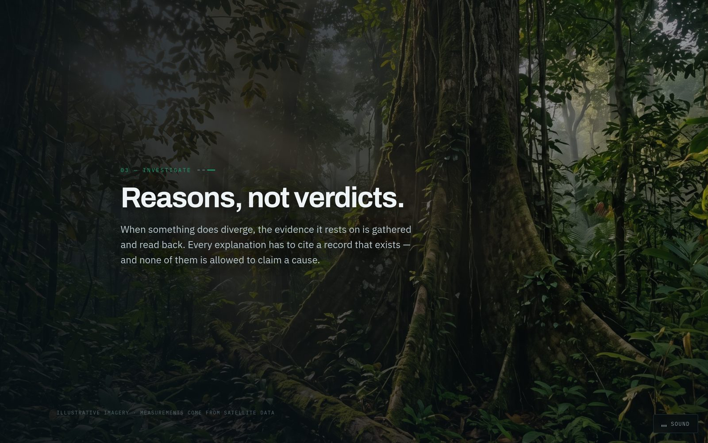

</div>
